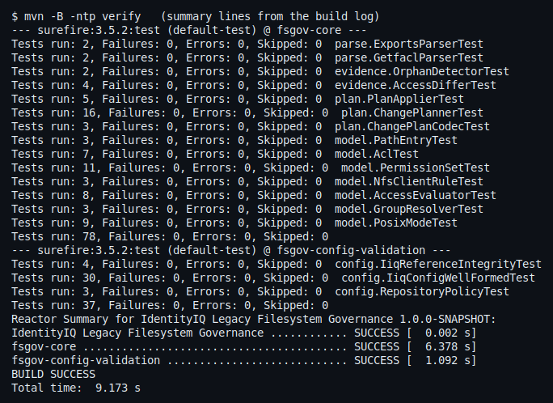
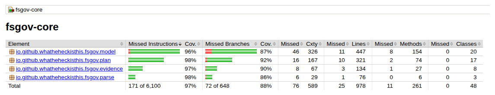
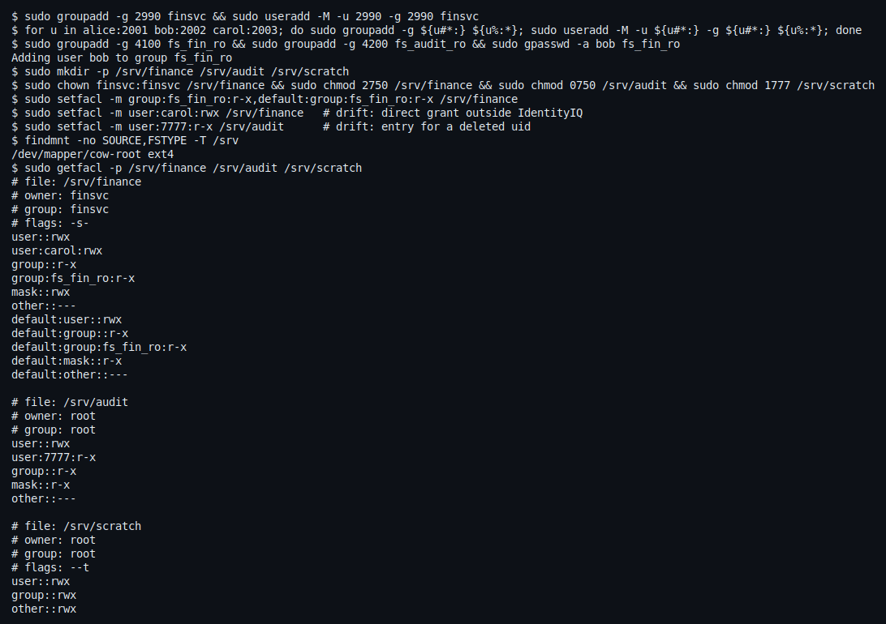
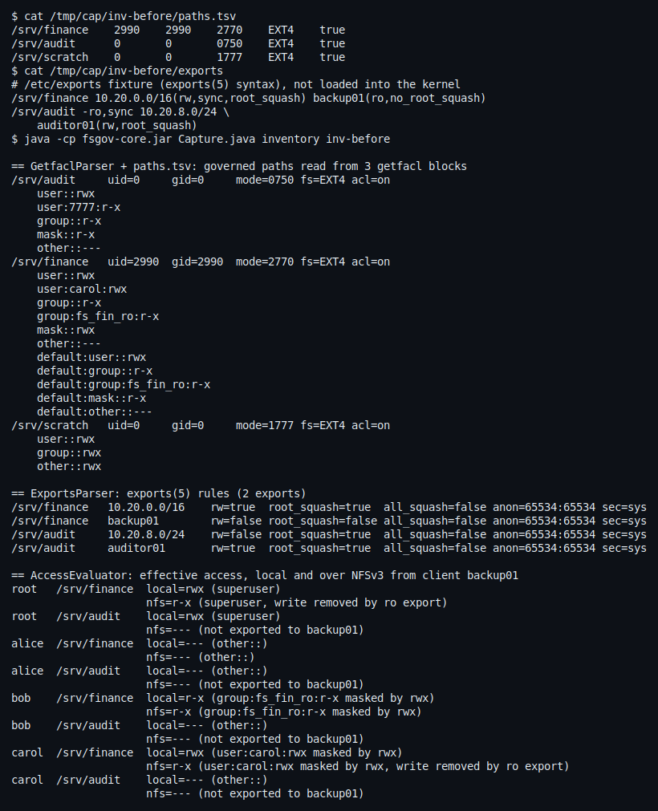
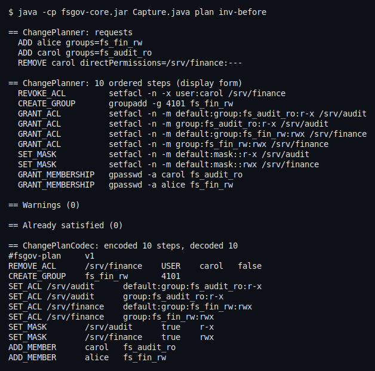
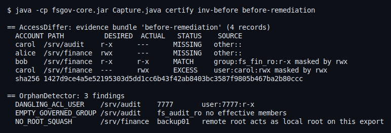
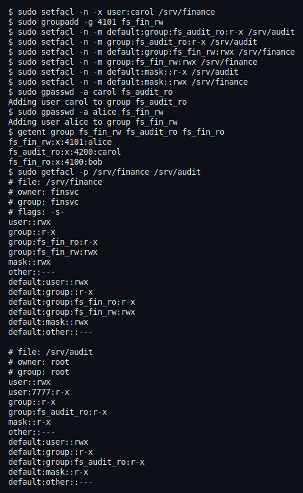
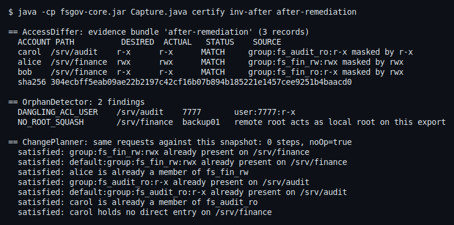

# Intent-Auditable Trust Object V3

This repository holds IdentityIQ Legacy Filesystem Governance, a SailPoint IdentityIQ project for governing legacy Linux file systems: POSIX and ACL provisioning, access certification, and JBoss EAP 7 deployment. Legacy file servers (ext3, ext4, XFS, published over NFSv3) hold regulated records but express access in owner, group and mode bits, POSIX.1e ACLs and export options that drift through manual change. This project brings that access under IdentityIQ: requests with approval, provisioning through an ordered and idempotent change plan, separation of duties between finance and audit write access, targeted and manager certifications, and evidence that a revocation took effect on disk. It is not a tested IdentityIQ deployment: the configuration has not been imported into a running IdentityIQ instance (see [Verification and testing](#verification-and-testing)).

The key words MUST, MUST NOT, SHALL, SHOULD and MAY in this document are to be interpreted as described in BCP 14 (RFC 2119 and RFC 8174).

## Contents

- [Key features](#key-features)
- [Scope](#scope)
- [Architecture](#architecture) (with [Documentation](#documentation))
- [Repository layout](#repository-layout)
- [Requirements](#requirements)
- [Build](#build)
- [Usage](#usage)
- [Configuration](#configuration)
- [Verification and testing](#verification-and-testing)
- [Figures](#figures)
- [Security](#security)
- [License](#license)

## Key features

| # | Feature | What runs | Checked by |
|---|---|---|---|
| 1 | [Ordered, idempotent provisioning change plan](#1-ordered-idempotent-provisioning-change-plan) | `ChangePlanner`, `PlanApplier` and `ChangePlanCodec` in `fsgov-core`, called by the `fsgov-iiq-adapter` connector | `ChangePlannerTest` (16), `PlanApplierTest` (5), `ChangePlanCodecTest` (3); Figures 5, 7 and 8 |
| 2 | [Legacy inventory parsing and effective access](#2-legacy-inventory-parsing-and-effective-access) | `GetfaclParser`, `ExportsParser`, `AccessEvaluator` and `GroupResolver` over POSIX modes, POSIX.1e ACLs and NFSv3 exports | `GetfaclParserTest` (2), `ExportsParserTest` (2), `AccessEvaluatorTest` (8) and six model test classes (36); Figures 3 and 4 |
| 3 | [Certification evidence and hygiene findings](#3-certification-evidence-and-hygiene-findings) | `AccessDiffer`, `EvidenceBundle` and `OrphanDetector`, feeding the certification definitions and the remediation evidence rule | `AccessDifferTest` (4), `OrphanDetectorTest` (2); Figures 6 and 8 |
| 4 | [IdentityIQ configuration and JBoss EAP 7 deployment](#4-identityiq-configuration-and-jboss-eap-7-deployment) | IdentityIQ XML under `config/`, JBoss EAP 7.4 material under `deploy/jboss-eap7/`, checked by `fsgov-config-validation` | `IiqConfigWellFormedTest` (30), `IiqReferenceIntegrityTest` (4), `RepositoryPolicyTest` (3); Figure 1 |

The numbers in parentheses are test counts from the Surefire reports of `mvn -B -ntp verify` (see [Verification and testing](#verification-and-testing)).

### 1. Ordered, idempotent provisioning change plan

- `fsgov-core`, a Java model, change planner and evidence library with JUnit 5 tests.
- `fsgov-iiq-adapter`, an IdentityIQ custom connector built only with the Maven profile `iiq`.
- The planner turns IdentityIQ style attribute requests (`groups`, `directPermissions`) into an ordered plan: revocations first (ACL entries, then memberships), then group creation, ACL grants, explicit mask steps and membership grants. A request that the snapshot already satisfies yields no step, and planning again against the result of a plan yields an empty plan.
- The connector queues the structured steps (`ChangePlanCodec`, format `#fsgov-plan v1`), and the host executor applies them; no command text is executed anywhere in this project.

### 2. Legacy inventory parsing and effective access

- The host collector contract consists of `getent passwd`, `getent group`, `getfacl` output, `/etc/exports` and `paths.tsv` (path, uid, gid, mode, file system type and ACL flag). `GetfaclParser` and `ExportsParser` read the last two formats as `getfacl` and exports(5) define them.
- `AccessEvaluator` computes effective permissions for an account on a path from the owner, named user and group entries, the mask, and group nesting, locally or as seen from an NFSv3 client with `ro`, `root_squash` and `all_squash` applied.
- File system families ext3, ext4, XFS and NFSv3 client mounts are modelled with their ACL support (mount option, native, or NFSACL side band).

### 3. Certification evidence and hygiene findings

- `AccessDiffer` compares the access IdentityIQ asserts with the effective access on disk and classifies each account and path pair as `MATCH`, `EXCESS`, `MISSING` or `DIVERGENT`. Excess access becomes a review item; after remediation a revoked item must be `MATCH`.
- `EvidenceBundle` holds the records in a canonical tab separated form with a SHA-256 digest, so the bundle is reproducible from the same inputs.
- `OrphanDetector` raises findings with no natural reviewer: unowned paths, dangling named ACL entries, empty governed groups, ungoverned or world writable paths, ACLs disabled on a governed mount, `no_root_squash` exports and nesting cycles.
- `config/CertificationDefinition/` defines the targeted file share review and the manager review; `Rule-FSGov-Remediation-Evidence.xml` and `Rule-FSGov-CertificationExclusion.xml` support them. See [Access certification design](docs/access-certification.md).

### 4. IdentityIQ configuration and JBoss EAP 7 deployment

- IdentityIQ XML artifacts under `config/` in the SSB layout, with `%%TOKEN%%` placeholders.
- `fsgov-config-validation`, build checks over `config/` and `deploy/`.
- JBoss EAP 7.4 notes, CLI scripts, module and snippets under `deploy/jboss-eap7/`.
- The separation of duties policy `Policy-FSGov-SoD-Finance-Audit.xml` forbids finance share write together with audit share write.

## Scope

The in scope components are listed under [Key features](#key-features).

Out of scope:

- The licensed `identityiq.jar` and `sailpoint.dtd`, which are not distributed with this repository.
- Executing command text: no command text is executed anywhere in this project.
- Jakarta EE 10 application servers (JBoss EAP 8, WildFly 27 and later); see [JBoss EAP 7 deployment](deploy/jboss-eap7/README.md).
- The host collector and executor agents that run on each file server. Their contract is defined in [Architecture](docs/architecture.md); their implementation is not part of this repository.

Limitations:

- The IdentityIQ artifacts have not been validated against `sailpoint.dtd` or imported into a running IdentityIQ instance, the adapter has not been compiled against `identityiq.jar` in CI, and the JBoss CLI scripts have not been run against a server in CI.
- No figure in this README shows IdentityIQ or JBoss EAP; both need a licensed or running server that the capture workflow does not have.
- Azure Files NFS and Azure NetApp Files do not support POSIX.1e ACLs as such, so named group entries need remapping on migration; see [Cloud migration notes](docs/cloud-migration.md).

Planned work:

- Import the configuration into a sandbox IdentityIQ 8.4 instance and test it there before any higher environment, as required under [Verification and testing](#verification-and-testing).
- Build the `iiq` profile against the licensed `identityiq.jar`.
- Run the JBoss CLI scripts against a JBoss EAP 7.4 server.

## Architecture

| Component | Location | Role |
|---|---|---|
| IdentityIQ artifacts | `config/` | Applications, rules, workflow, certification definitions, tasks, policy and roles, deployed with the SSB token model. |
| fsgov-core | `src/fsgov-core` | Java model of file system access, change planning, evidence and hygiene detection, with no IdentityIQ dependency. |
| fsgov-iiq-adapter | `src/fsgov-iiq-adapter` | IdentityIQ custom connector that uses fsgov-core. Built only with the `iiq` profile. |
| Config validation | `src/fsgov-config-validation` | Build time checks that parse every XML artifact and verify cross references and repository policy. |
| JBoss deployment | `deploy/jboss-eap7` | Datasource, JDBC module, Elytron credential store, OIDC sign in and web tier settings for JBoss EAP 7.4. |

```text
host collector (getent, getfacl, /etc/exports, paths.tsv)
  -> aggregation into the Legacy Linux Filesystem application
  -> access request, approval workflow or certification revoke
  -> ProvisioningPlan -> BeforeProvisioning rule -> fsgov connector
  -> ChangePlanner -> ChangePlan -> change queue (fsgov-plan v1)
  -> host executor -> next aggregation confirms the change
```

The full data flow, key decisions and trust boundaries are in [Architecture](docs/architecture.md).

### Documentation

- [Architecture](docs/architecture.md)
- [Legacy file system provisioning design](docs/legacy-filesystem-provisioning.md)
- [Access certification design](docs/access-certification.md)
- [Cloud migration notes](docs/cloud-migration.md)
- [Runbook](docs/runbook.md)
- [JBoss EAP 7 deployment](deploy/jboss-eap7/README.md)
- [Security policy](docs/SECURITY.md)

## Repository layout

```text
config/                    IdentityIQ XML artifacts (SSB layout, %%TOKEN%% placeholders)
  Application/             HR delimited authoritative source, legacy Linux file system
  Rule/                    BuildMap, Correlation, Before and After Provisioning,
                           Certification exclusion, remediation evidence, SSO, library
  CertificationDefinition/ Targeted file share review, manager review
  Workflow/                Access request approval
  TaskDefinition/          Aggregation and identity refresh
  TaskSchedule/            Certification generation
  Policy/                  SoD: finance share write vs audit share write
  Bundle/                  IT and business roles
  ManagedAttribute/        Entitlement catalog with share bindings
  Configuration/           Connector registry entry
sandbox.target.properties  Token values for the sandbox environment
src/
  fsgov-core/              Pure Java model, change planner, evidence (JUnit 5)
  fsgov-config-validation/ Build checks over config/ and deploy/
  fsgov-iiq-adapter/       IdentityIQ custom connector (Maven profile iiq)
deploy/jboss-eap7/         JBoss EAP 7.4 notes, CLI scripts, module and snippets
docs/                      Architecture, provisioning, certification, cloud migration,
                           runbook, security policy
docs/screenshots/          Figures and their text transcripts, produced by captures.yml
.github/workflows/         ci.yml (Maven verify), captures.yml (figures)
```

## Requirements

- A JDK 17 or later and Maven MUST be available to build.
- The IdentityIQ adapter MUST be built against the licensed `identityiq.jar` (version 8.4 in the install command below).

## Build

```console
$ mvn -B verify
```

The default build runs the core unit tests with a coverage gate and parses every XML file under `config/` and `deploy/`. It checks that each IdentityIQ artifact declares the `sailpoint.dtd` DOCTYPE, that every object reference and rule name resolves, that every `%%TOKEN%%` has a value, and that the repository contains no script sources.

The IdentityIQ adapter needs the licensed `identityiq.jar`:

```console
$ mvn install:install-file -Dfile=identityiq.jar -DgroupId=sailpoint -DartifactId=identityiq -Dversion=8.4 -Dpackaging=jar
$ mvn -B -Piiq verify
```

## Usage

The following shows how a grant becomes a change on disk:

```java
ChangePlan plan = new ChangePlanner(catalog).plan(snapshot,
        List.of(ProvisioningRequest.addGroup("alice", "fs_fin_rw")));
plan.describe();
// groupadd -g 4101 fs_fin_rw
// setfacl -n -m default:group:fs_fin_rw:rwx /srv/finance
// setfacl -n -m group:fs_fin_rw:rwx /srv/finance
// setfacl -n -m mask::rwx /srv/finance
// setfacl -n -m default:mask::rwx /srv/finance
// gpasswd -a alice fs_fin_rw
```

The lines above are a display form for reviewers. The connector queues the structured steps (`ChangePlanCodec`), and the host executor applies them; no command text is executed anywhere in this project.

Deployment, import order and operation are described in the [Runbook](docs/runbook.md).

## Configuration

- `sandbox.target.properties` holds the token values for the sandbox environment. Its values are placeholders; credentials MUST NOT be placed in this file.
- `config/` contains the IdentityIQ artifacts, grouped as shown in [Repository layout](#repository-layout).

## Verification and testing

- `fsgov-core` and the configuration checks run in CI (Maven verify on Java 17) on each push to `main` and on each pull request.
- The IdentityIQ artifacts are checked for well formedness and internal consistency only. `sailpoint.dtd` is not public, so they have not been validated against it, and none of them has been imported into a running IdentityIQ instance.
- The adapter has not been compiled against `identityiq.jar` in CI.
- The JBoss CLI scripts have not been run against a server in CI.

The configuration SHOULD be treated as a reviewed starting point for an implementation. It MUST be imported and tested in a sandbox before any higher environment.

Test results of `mvn -B -ntp verify` on `ubuntu-24.04` with Temurin 17 (Figure 1):

| Module | Test classes | Tests | Failures | Errors | Skipped |
|---|---|---|---|---|---|
| `fsgov-core` | 14 | 78 | 0 | 0 | 0 |
| `fsgov-config-validation` | 3 | 37 | 0 | 0 | 0 |
| Total | 17 | 115 | 0 | 0 | 0 |

JaCoCo 0.8.12 reports 97 percent instruction coverage (171 of 6,100 instructions missed) and 88 percent branch coverage (72 of 648 branches missed) for `fsgov-core` (Figure 2). The build enforces a minimum of 85 percent line coverage and 70 percent branch coverage.

The workflow [`captures.yml`](.github/workflows/captures.yml) also runs `fsgov-core` against a fixture that it creates on the runner's own ext4 file system: local users and groups, directories under `/srv` with POSIX.1e ACLs set by `setfacl`, and an exports(5) file that is parsed but not loaded into the kernel. The collector inventory is taken with `getent`, `getfacl -p`, `stat` and `findmnt`. To stand in for the host executor, the workflow runs the display form of the plan with `sudo` on the disposable runner, collects the inventory again, and checks the evidence and the idempotency of the plan against the new state (Figures 3 to 8). The capture driver is Java and is written to `/tmp` by the workflow, so it is not part of the repository.

## Figures

Every figure is a screenshot from a run of [`captures.yml`](.github/workflows/captures.yml) on `ubuntu-24.04`. Terminal output is shown in `xterm` on Xvfb and captured with ImageMagick `import`; the coverage report is rendered by headless Google Chrome. The text shown in each terminal figure is kept beside it in `docs/screenshots/` as a `.txt` transcript.

| Figure | Subject | Tool | Source |
|---|---|---|---|
| [1](#figure-1) | Build and unit tests | Maven, Surefire, xterm | [`01-build.txt`](docs/screenshots/01-build.txt) |
| [2](#figure-2) | Coverage of `fsgov-core` | JaCoCo, headless Chrome | `src/fsgov-core/target/site/jacoco/index.html` |
| [3](#figure-3) | POSIX ACL fixture on the runner | `useradd`, `setfacl`, `getfacl`, xterm | [`03-fixture.txt`](docs/screenshots/03-fixture.txt) |
| [4](#figure-4) | Inventory parsing and effective access | `GetfaclParser`, `ExportsParser`, `AccessEvaluator` | [`04-inventory.txt`](docs/screenshots/04-inventory.txt) |
| [5](#figure-5) | Change plan and queue encoding | `ChangePlanner`, `ChangePlanCodec` | [`05-plan.txt`](docs/screenshots/05-plan.txt) |
| [6](#figure-6) | Certification evidence before remediation | `AccessDiffer`, `OrphanDetector` | [`06-cert-before.txt`](docs/screenshots/06-cert-before.txt) |
| [7](#figure-7) | Plan applied on the runner | `setfacl`, `gpasswd`, `getfacl` | [`07-apply.txt`](docs/screenshots/07-apply.txt) |
| [8](#figure-8) | Certification evidence after remediation | `AccessDiffer`, `OrphanDetector`, `ChangePlanner` | [`08-cert-after.txt`](docs/screenshots/08-cert-after.txt) |

<a id="figure-1"></a>
<p align="center"><a href="docs/screenshots/01-maven-build-tests.png"></a><br><sub><b>Figure 1.</b> <code>mvn -B -ntp verify</code>: 78 tests in 14 classes of <code>fsgov-core</code> and 37 tests in 3 classes of <code>fsgov-config-validation</code>, with no failures, errors or skips, and BUILD SUCCESS.</sub></p>

<a id="figure-2"></a>
<p align="center"><a href="docs/screenshots/02-jacoco-coverage.png"></a><br><sub><b>Figure 2.</b> JaCoCo report for <code>fsgov-core</code> after the unit tests: 97 percent instruction coverage and 88 percent branch coverage over 48 classes in four packages.</sub></p>

<a id="figure-3"></a>
<p align="center"><a href="docs/screenshots/03-posix-acl-fixture.png"></a><br><sub><b>Figure 3.</b> Fixture on the ext4 file system that holds <code>/srv</code> on the runner: users and governed groups, <code>/srv/finance</code> (2750 with a default ACL), <code>/srv/audit</code> and <code>/srv/scratch</code>, two drift entries (<code>user:carol:rwx</code> and <code>user:7777:r-x</code>), and the resulting <code>getfacl -p</code> output.</sub></p>

<a id="figure-4"></a>
<p align="center"><a href="docs/screenshots/04-inventory-parse-evaluate.png"></a><br><sub><b>Figure 4.</b> The collector inventory parsed by <code>GetfaclParser</code> and <code>ExportsParser</code>, and effective access from <code>AccessEvaluator</code>, locally and from NFSv3 client <code>backup01</code>, where the <code>ro</code> export removes write. The mode column comes from <code>stat</code>, whose group bits show the ACL mask.</sub></p>

<a id="figure-5"></a>
<p align="center"><a href="docs/screenshots/05-change-plan.png"></a><br><sub><b>Figure 5.</b> <code>ChangePlanner</code> output for three requests (grant <code>fs_fin_rw</code> to alice, grant <code>fs_audit_ro</code> to carol, remove carol's direct entry on <code>/srv/finance</code>): ten steps with the revocation first, no warnings, and a <code>ChangePlanCodec</code> round trip of all ten steps.</sub></p>

<a id="figure-6"></a>
<p align="center"><a href="docs/screenshots/06-certification-evidence-before.png"></a><br><sub><b>Figure 6.</b> Evidence before remediation: two <code>MISSING</code> records, one <code>MATCH</code> and one <code>EXCESS</code> (carol's direct <code>rwx</code> on <code>/srv/finance</code>), with three hygiene findings: a dangling ACL entry for uid 7777, an empty governed group and a <code>no_root_squash</code> export.</sub></p>

<a id="figure-7"></a>
<p align="center"><a href="docs/screenshots/07-plan-applied-getfacl.png"></a><br><sub><b>Figure 7.</b> The display form of the plan run by the workflow on the disposable runner in place of a host executor, followed by <code>getent group</code> and <code>getfacl -p</code> showing the new group entries and default ACLs and no entry for carol on <code>/srv/finance</code>.</sub></p>

<a id="figure-8"></a>
<p align="center"><a href="docs/screenshots/08-certification-evidence-after.png"></a><br><sub><b>Figure 8.</b> Evidence after remediation, from a fresh inventory: three <code>MATCH</code> records and the two findings outside the requests. Planning the same requests again yields zero steps and reports seven already satisfied conditions.</sub></p>

## Security

Security reporting and commit signature verification are described in [SECURITY.md](SECURITY.md); the maintainer signing key is published in [KEYS.asc](KEYS.asc).

## License

MIT. See [LICENSE](LICENSE).
